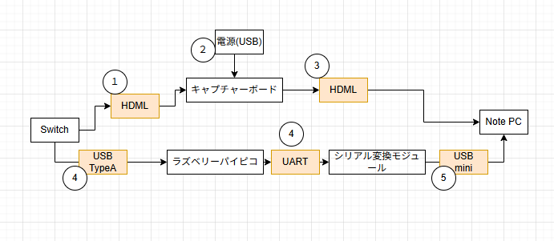
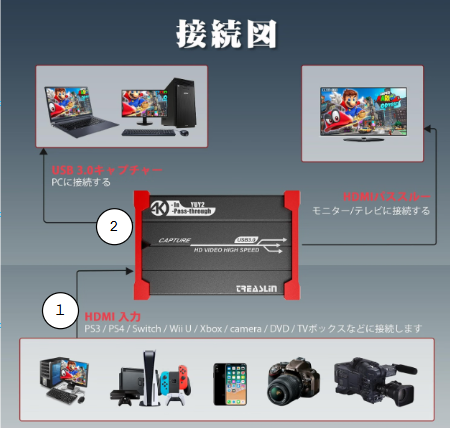
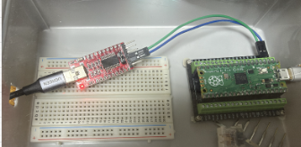
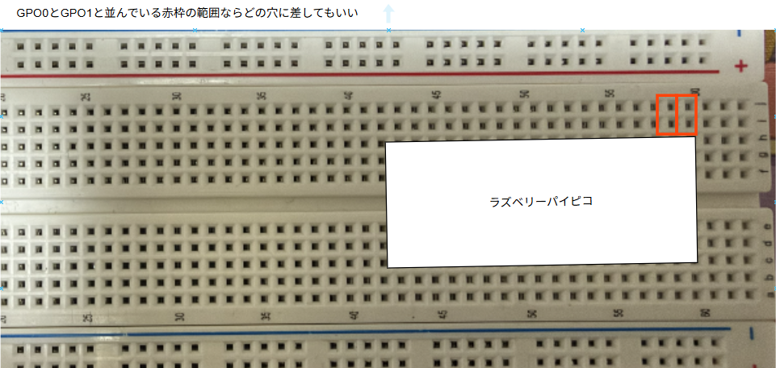

# 機器の接続方法

①：SwitchのHDMLポートとキャプチャーボードのINのところを接続

②：キャプチャーボードとNotePCをUSBで接続

③：SwitchのUSBとラズベリーパイを接続

④：ラズベリーパイピコのGPO0とシリアル変換モジュールのRXを接続、ラズベリーパイピコのGPO1とシリアル変換モジュールのTXを接続

⑤：シリアル変換モジュールのUSBポートとPCを接続

