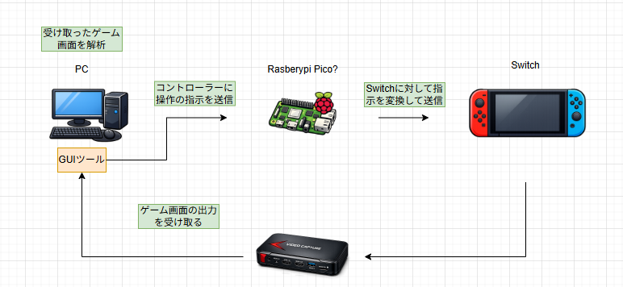

# 2. システム概要

## 2.1 システムの概要
AutoPlayCraftは、自動ゲーム操作を実現するためのシステムです。

## 2.2 主要構成
- GUIアプリ: PC上で動作する操作・管理用インターフェース
- コントローラー側: ゲーム操作を実行するデバイス
- AI推論エンジン: 画像認識と判断を行うモジュール
- 通信インターフェース: UART / USB HID Vendor
- Nintendo Switch: 対象ゲーム機

## 2.3 処理フロー
1. GUIアプリがPC上で動作する  
2. PCがAIへゲーム画面情報を送信する  
3. PCがAIの判定結果をもとに制御信号を生成する  
4. コントローラー側がSwitchへ入力を送信する  

## 2.4 通信仕様
- UART: 115200bps
- USB HID Vendor: 1ms間隔
