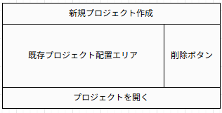
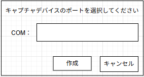
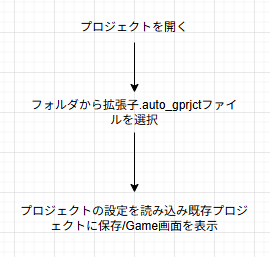

# プロジェクト選択画面

| 名前 | コントロールの種類 | 処理 |
| :----: | :----: | :---: |
|新規プロジェクト作成| ボタン | 新規プロジェクト作成用のフォームを開く |
|既存プロジェクト配置エリア| ボタン | プロジェクトを保存した場合に次回から表示される |
|削除ボタン| ボタン | 既存プロジェクトの項目の横にセットで配置される。押すと同じ行の既存プロジェクトを削除する |
|プロジェクトを開く| ボタン | 別のフォルダにあるプロジェクトを読み込む |

## 新規プロジェクト作成用画面

| 名前 | コントロールの種類 | 処理 |
| :----: | :----: | :---: |
| キャプチャデバイスのポートを選択してください | ラベル | 操作を分かりやすくする |
| COM | ラベル | ポートの種類を明示 |
| ポート表示 | コンボボックス | ドロップダウンにより現在デバイスとつながっているポートを表示 |
|作成ボタン| ボタン | プロジェクトを保存しGame画面を開く |
|キャンセル| ボタン | 操作を取り消しプロジェクト選択画面に戻る |

## プロジェクトを開く
